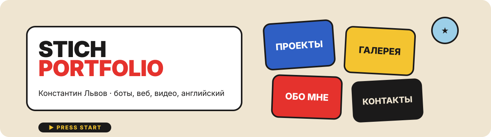
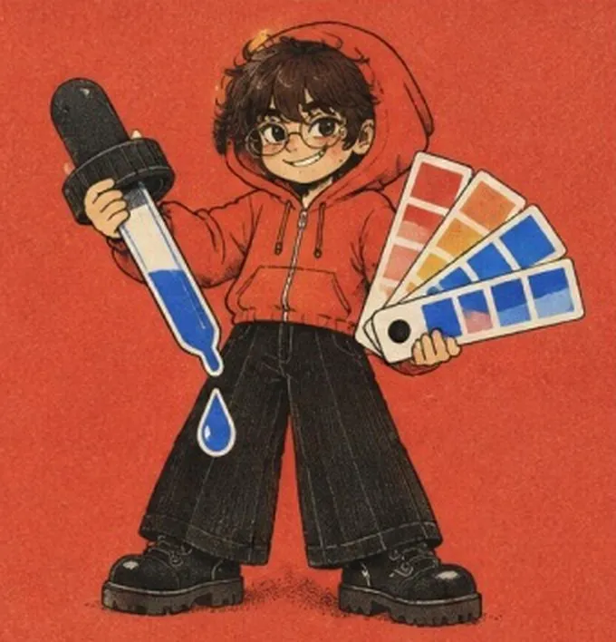

<p align="center"></p>

<div align="center">

[](https://stich-135-106-163-67.sslip.io)


</div>

Личный сайт с собственным маскотом: разделы «Главная», «Проекты», «Галерея», «Обо мне» и «Контакты». Весь текст и картинки правятся прямо на сайте во встроенном режиме редактора, без правки кода.

<p align="center">
  
  
  
  
  
</p>

## 🟦 Что умеет

- **Режим редактора:** вход по паролю, правка контента и загрузка картинок прямо на страницах
- **Маскот** — свой персонаж в разных позах на каждом разделе
- **Форма связи:** сообщения с сайта приходят в Telegram
- **AI-мини-чат** в футере ([stich-ai-chat](https://github.com/lvovkonstantin57-del/stich-ai-chat)) с админкой для ключа
- **Безопасность:** пароль хранится только как хэш PBKDF2, сессии подписаны HMAC, лимиты запросов, cookie `Secure` на HTTPS
- **Картинки:** при загрузке поворачиваются по EXIF, уменьшаются до 2000 px и сохраняются в WebP без метаданных (Pillow)

## 🟨 Как устроено

```
server/                 бэкенд на FastAPI
  main.py               контент, вход в редактор, загрузка картинок, форма сообщения
  ai_module.py          AI-мини-чат и его админка
  hash_password.py      получить хэш пароля редактора
dist/                   собранный фронтенд (React + Vite), его отдаёт Caddy
.env.example            настройки сервера
```

| Метод | Путь | Что делает |
|---|---|---|
| GET | `/api/content` | контент сайта |
| PUT | `/api/content` | сохранить контент (только редактор) |
| POST | `/api/login`, `/api/logout` | вход и выход из режима редактора |
| POST | `/api/upload` | загрузить картинку (только редактор) |
| POST | `/api/message` | сообщение из формы → Telegram |
| POST | `/api/chat` | AI-мини-чат |

> **Про фронтенд.** В репозитории лежит собранная версия (`dist/`) — ровно то, что сейчас работает на сайте. Исходники React-компонентов в этот репозиторий не попали.

## 🟥 Запуск

```bash
python3 -m venv .venv && . .venv/bin/activate
pip install -r server/requirements.txt
cp .env.example .env
python -m server.hash_password          # хэш пароля → ADMIN_PASSWORD_HASH в .env
uvicorn server.main:app --reload --port 8000
```

Контент и загруженные картинки хранятся в `data/` (в git не попадает). На сервере Caddy отдаёт `dist/`, `/uploads/*` — из `data/uploads`, а `/api/*` проксирует на uvicorn.

---

<sub>Автор — [Константин Львов](https://github.com/lvovkonstantin57-del) · [Telegram](https://t.me/l1ttleStich)</sub>
